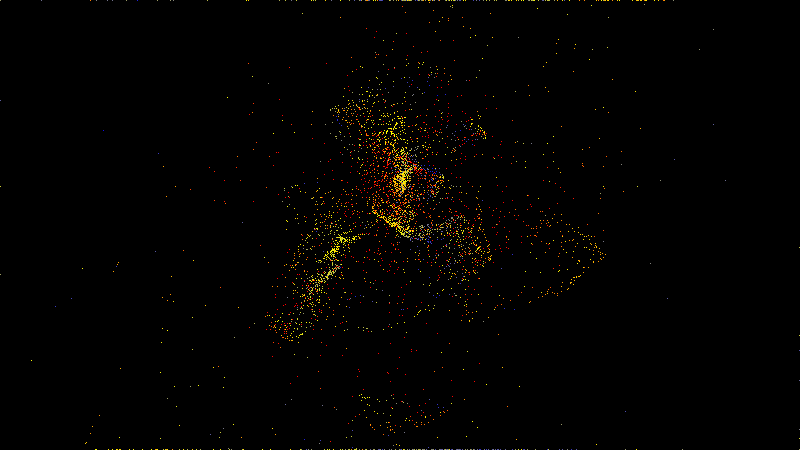
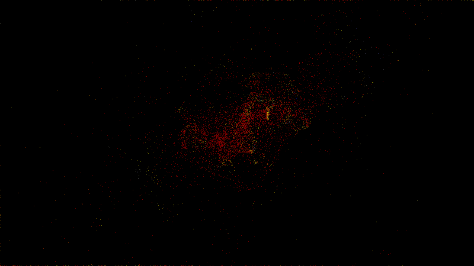
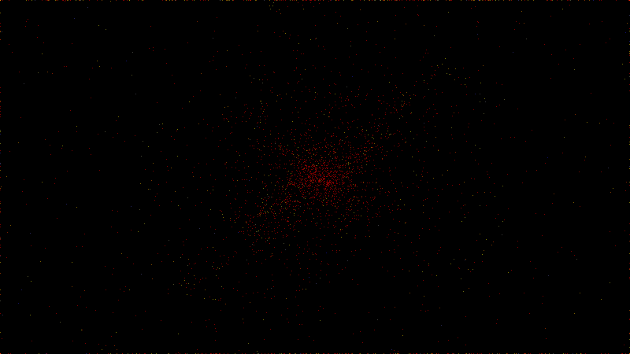
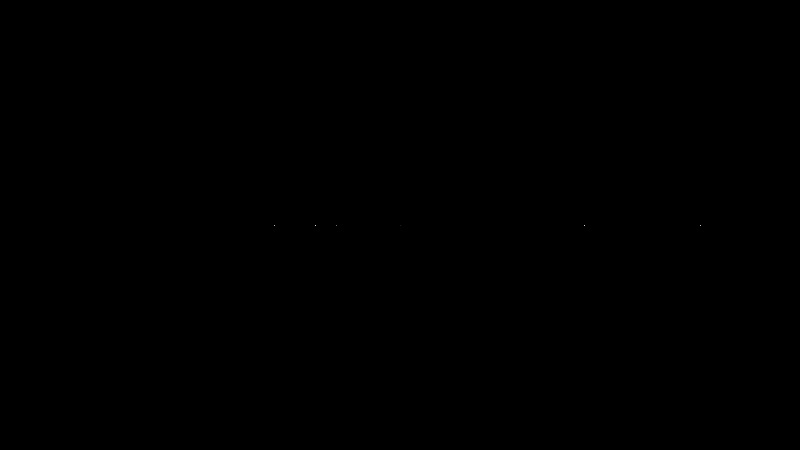

# 🌌 cosmos-cinema

**EN:** A gravitational **N-body universe simulator** from scratch: direct-summation gravity over hundreds of millions of interacting pairs, leapfrog integration, galaxy disks with analytic rotation curves — filmed as animated GIFs where every pixel is a star and its color is its speed.

**TR:** Sıfırdan yazılmış yerçekimi **N-kütle evren simülatörü**: yüz milyonlarca etkileşen kütleçekim çifti üzerinde doğrudan özetleme, leapfrog entegrasyonu, analitik dönme eğrili galaksi diskleri — her pikselin bir yıldız, renginin hızı olduğu GIF'lerle filmlenir.



> 3.8 milyar komutu emüle eden silicon-cinema'dan sonra, bu repo aynı makineye **~1 milyar kütleçekim çifti hesabı** aldırdı.

## 🖼️ Gallery / Galeri

### 🌌 Collision / Çarpışma — [`scenes/collision.json`](scenes/collision.json)

Two spiral galaxies, 12,002 particles, grazing encounter — tidal tails rip out exactly like the Antennae galaxies. — *İki sarmal galaksi, 12.002 parçacık, yana çarpışma — gelgit kuyrukları Antennae gökadalaları gibi kopar.*

### 🗿 Colossus / Kolos — [`scenes/colossus.json`](scenes/colossus.json)

The limit test: 20,002 particles, 1,000 steps — **~4 billion** gravity pair computations. — *Limit testi: 20.002 parçacık, 1.000 adım — ~4 milyar kütleçekim çifti.*

### ⭐ Cluster / Küme — [`scenes/cluster.json`](scenes/cluster.json)

An 8,000-star Plummer cluster collapsing and virializing around a massive core. — *8.000 yıldızlı Plummer kümesi, ağır çekirdek etrafında çöküp dengeye giriyor.*

### ☀️ Solar / Güneş Sistemi — [`scenes/solar.json`](scenes/solar.json)

Five planets, 3,000 steps, crystalline orbital trails — the analytic validation scene. — *Beş gezegen, 3.000 adım, kristal yörünge izleri — analitik doğrulama sahnesi.*

## 🧱 Physics / Fizik

| Piece | Detail |
|---|---|
| 🌍 Gravity | Direct O(N²) summation, **blocked NumPy** (2048'lik dilimler, bellek dostu) |
| 🎯 Integrator | Leapfrog kick-drift-kick — semplektik, enerji saptırmasi ~%0.05 |
| 🌀 Galaxies | Analytic rotation curve v = √(GM_core/r) + massive core + disk thickness |
| ⭐ Clusters | Plummer sphere sampling |
| 🎞️ Render | Mass histogram + per-bin mean speed → thermal palette, log-density brightness |

## ✅ Verification / Doğrulama

```bash
python3 tests/verify.py
```

- **Kepler**: iki cisim dairesel yörüngesi bağlı kalmalı (r < 1.3×r₀) ve enerji sapması <%0.5
- **Momentum**: kütleçekimi iç kuvvet — toplam momentum FLOAT hassasiyetinde sabit
- **Newton 3**: a₁m₁ == −a₂m₂ (bloklu özetlemede kuvvet simetrisi)
- **Determinizm**: aynı seed → aynı evren

Geliştirme sırasında yakalanan bug: ivme formülündeki işaret hatası kütleçekimi İTİYORDU — Kepler kapısı yörüngenin patlamasıyla anında yakaladı.

## 🚀 Usage / Kullanım

```bash
pip install numpy
python3 cosmos.py --scene scenes/collision.json
python3 cosmos.py --scene scenes/colossus.json --preview
```

## 🧪 Why / Neden

**TR:** Galaksi çarpışması videoları süperbilgisayarlarda yapılır sanılır. Bu proje: aynı fiziği (doğrudan özetleme + semplektik entegratör), sıradan bir MacBook'ta, milyarlarca çift hesabla çalıştırıyor — ve "güzel animasyon" değil, **enerji/momentum kapılarıyla kanıtlı** simülasyon üretiyor. Serinin en ağır hesap işi.

## 📄 License

MIT
